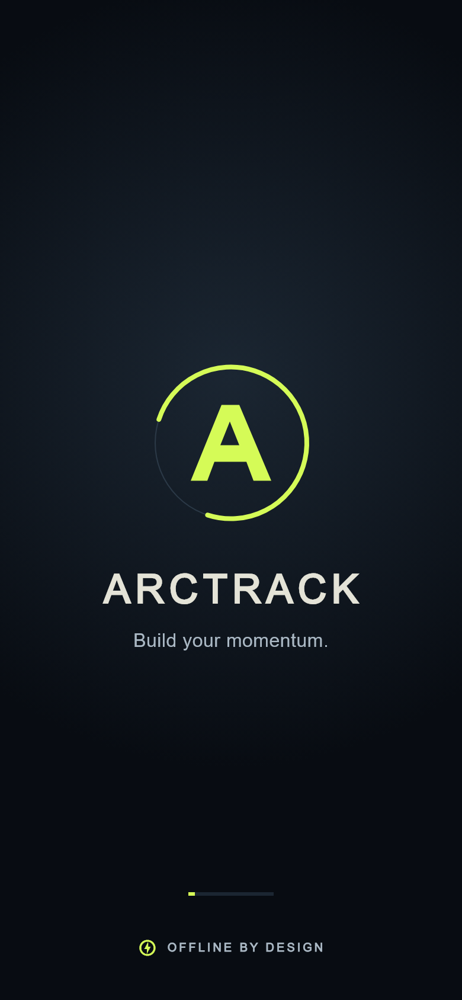
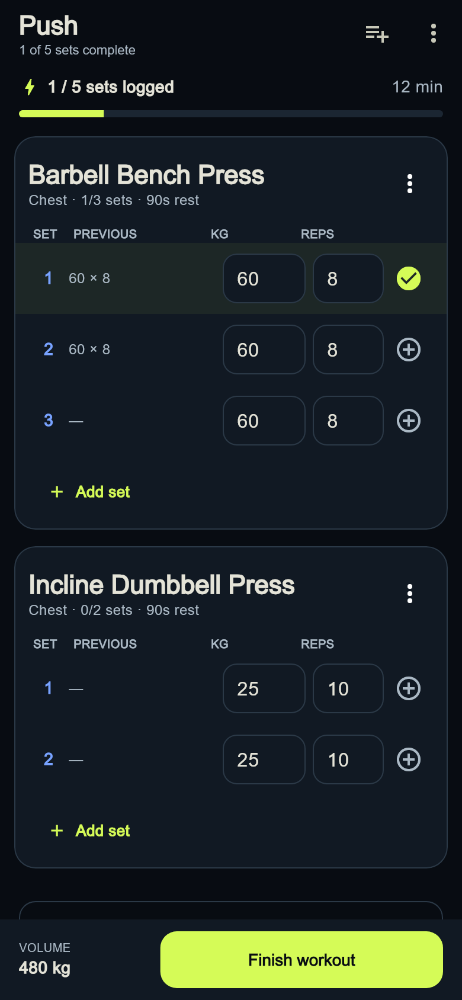
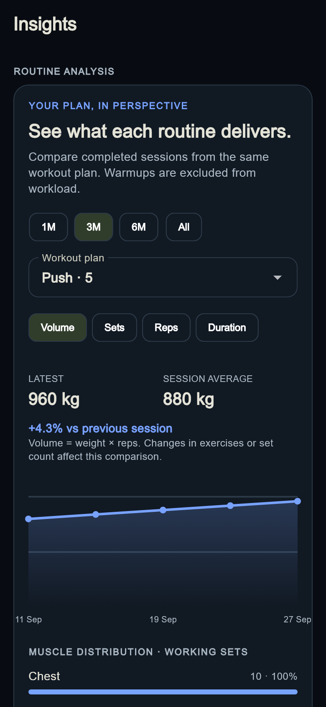

# ArcTrack

**An offline gym tracker for workout planning, fast logging, and useful progress insights.**

Build repeatable routines, train with your previous values ready, and see how each
workout plan evolves over time. ArcTrack is an Android-first Flutter application
with a dark interface, clear set entry, and local SQLite storage.

- **Works offline:** planning, logging, history, and analytics work without an
  internet connection. No account or subscription is required.
- **Your data stays on your device:** backups and exports are optional. If you
  choose a Google Drive file through Android, Drive handles cloud uploads when
  connectivity is available.
- **Resume where you left off:** active workouts and completed history are saved
  locally.

## Screenshots

Flutter-rendered phone previews using sample training data.

| Branded startup | Workout logging | Routine insights |
| --- | --- | --- |
|  |  |  |

## Features

- Four main areas: Home, Train, Program, and Insights. Workout history and
  backup remain available from Insights and settings.
- Rolling training rotations with repeatable rest days.
- Fixed seven-day weekly schedules, including rest and unscheduled days.
- Custom exercises and reusable workout routines.
- Strength, bodyweight, assisted, timed, and distance exercise types.
- Assisted pull-ups and dips with explicit assistance entry and per-workout body weight.
- Fast workout logging with previous values, set completion, optional advanced
  fields, and exercise-specific rest timers.
- Add, insert, or remove exercises while a workout is active.
- Resume an interrupted workout after restarting the app.
- Delete routines or individual completed workouts with confirmation.
- Body weight, measurements, recovery check-ins, workload, estimated 1RM,
  records, frequency, and streak tracking.
- Kilograms/pounds and metric/imperial display conversion while retaining
  normalized metric values internally.
- Excel-based bulk plan and history import.
- CSV history export and JSON backup/restore.
- Optional single-file automatic backup through Android's document provider.
- Native Android splash screen, adaptive launcher icon, and double-back exit.

## Main areas

### Home

Shows the next workout, a direct start or resume action, recent training
momentum, the upcoming schedule, and an optional self-reported recovery
check-in. A missed day does not silently advance a rolling rotation.

### Program

Create or edit routines, manage exercises, choose between a rolling rotation
and fixed weekly schedule, add rest days, reorder rotation entries, or import a
complete plan from Excel. Deleting a routine removes its schedule references
but keeps historical workouts.

### Train

Log weight and repetitions, complete sets, add or remove sets, access optional
set details, and run the configured rest timer. Exercises can be appended or
inserted after a particular movement during the session using exercise or muscle
search. Tap previous values to fill a set, or the set number to edit details.
A progress bar and per-exercise counts track completion; rest controls support
adding 30 seconds or skipping. Empty sets cannot be marked complete, and swiped
sets can be restored with Undo. Changes are autosaved.

### Insights

Compares four-week workout frequency, shows weekly workouts or working sets on
their own scale, and charts exercise trends with dated sessions and range
filters, best-in-range results, and session counts. Routine analysis groups
history by workout-plan ID, with date filters, volume/sets/reps/duration trends,
latest-versus-previous comparisons, session averages, muscle distribution, and
session breakdowns. Deleted or renamed routines retain their historical data.
Workload excludes warmup and unfinished sets. It also includes body-weight trends
and personal records.

### History

Open from Insights or Home settings to review or delete completed workouts,
export CSV/JSON, restore a JSON backup, and configure automatic backup.

## Assisted exercise logging

Choose **assisted** as the tracking type, or use the built-in Assisted Pull-up
and Assisted Dip exercises. The weight input is the machine's **assistance
weight**, not an external weight you are lifting.

**Estimated effective load = body weight − assistance weight.** For example,
80 kg body weight with 20 kg assistance gives an estimated 60 kg effective load;
10 repetitions contribute 600 kg to working-set volume. Zero assistance is valid.
Assistance above body weight is clamped to zero effective load.

Set body weight directly in the active workout. Starting a workout also uses the
latest body measurement available at that time. The value is saved with the
session, so later body-weight measurements do not rewrite its calculation. Older
sessions use the latest measurement on or before their workout date. If body
weight is unavailable, assistance and repetitions remain trackable, while the
assisted sets are excluded from volume and effective-load trends.

Insights reports **least assistance** (lower means less help), repetitions, and
effective load separately. This is a simple estimate; machine mechanics and
movement technique can affect the actual resistance.

## Backup and restore

ArcTrack provides three JSON workflows:

1. **Share JSON backup** sends a snapshot through Android's share sheet.
2. **Restore file** or **Paste JSON** validates a backup, shows a summary, and
   asks for confirmation before replacing local data.
3. **Choose backup file** creates one persistent backup file. After each data
   update, ArcTrack overwrites that same file instead of creating dated copies.

When Google Drive is selected in Android's file picker, Drive is responsible for
uploading and retrying synchronization when internet access is available.
ArcTrack itself remains usable offline and does not request Google credentials.

Uninstalling the app removes its saved permission to the backup location, but
does not delete the backup file. After reinstalling:

1. Open History and select **Restore file**.
2. Choose the existing `ArcTrack_backup.json` file and restore it.
3. Select **Use existing** and choose the same file to resume automatic updates
   without creating another backup.

Automatic backup is optional and can be disabled from History. Local SQLite
saving remains the source of truth if the selected document provider is
temporarily unavailable.

## Excel bulk import

From Plan, choose **Share Excel template**, edit the workbook, then select
**Import Excel**.

The workbook uses these sheets:

### `Plan`

| Column | Purpose |
| --- | --- |
| `mode` | `rolling` or `weekly` |
| `slot` | Rotation number (`1`, `2`, ...) or weekday name |
| `workout` | Routine name; use `Rest` for a rest day |
| `exercise` | Exercise name; leave empty for Rest |
| `muscle` | Primary muscle group |
| `type` | `strength`, `bodyweight`, `assisted`, `timed`, or `distance` |
| `sets` | Target set count, from 1 to 20 |
| `reps` | Target repetitions |
| `rest_seconds` | Rest duration, from 0 to 900 seconds |

Use one row per exercise. Repeat the same mode, slot, and workout values for all
exercises belonging to one routine.

### `History`

| Column | Purpose |
| --- | --- |
| `date` | `YYYY-MM-DD HH:MM` |
| `workout` | Workout name |
| `exercise` | Exercise name |
| `set` | Set number |
| `weight_kg` | Weight in kilograms; assistance weight for assisted exercises |
| `reps` | Completed repetitions |
| `completed` | `true` or `false` |

Matching routine names are updated. Existing workout history is retained, and
reimporting the same dated workout does not create another copy.

## Development setup

### Requirements

- Flutter `>=3.44.0` with Dart `>=3.12.2 <4.0.0`
- Android SDK with API 36 available
- Java 17
- An Android device or emulator

Check the environment and install packages:

The UI currently loads the local `liquid_ui_components` development checkout
from `../mahila-mitr/liquid_retina_navigation`. Keep that sibling checkout in
place when running `flutter pub get`; it provides the morph and interaction APIs.

```powershell
flutter doctor
flutter pub get
```

Run the app:

```powershell
flutter run
```

For device performance checks, use `flutter run --profile`; debug builds include
development overhead. Glass panels use translucent tints and painted rims with
zero backdrop blur, no optical shaders, and no blurred shadows. The Home morph
remains animated, and small controls use reduced press dynamics.

Build the release APK for everyday use:

```powershell
flutter build apk --release
```

Output: `build/app/outputs/flutter-apk/app-release.apk`.

Run static analysis and tests:

```powershell
flutter analyze
flutter test
```

Build an installable debug APK:

```powershell
flutter build apk --debug
```

The APK is written to:

```text
build/app/outputs/flutter-apk/app-debug.apk
```

## Architecture

```text
lib/
├── application/   Riverpod controller and application operations
├── data/          SQLite repository, Excel import, and backup bridge
├── domain/        Serializable domain models and calculations
├── ui/            Theme, shared widgets, and feature screens
└── main.dart      Routing, app shell, and Android back handling
```

- **Riverpod** manages application state and autosave coordination.
- **GoRouter** provides the four-section navigation shell and workout history route.
- **Drift/SQLite** stores a serialized, version-tolerant local data model.
- Stable IDs keep domain records independent from presentation and allow a
  future repository implementation to add synchronization.
- The Android document-provider bridge retains access to exactly one selected
  backup URI and rewrites its contents after meaningful changes.

## Data and privacy

- No account is required.
- No telemetry, advertising, or social tracking is included. Training analytics are calculated locally.
- The primary database stays inside the app's private storage.
- ArcTrack accesses a backup file only after the user selects it through the
  Android system picker.
- Importing a JSON backup replaces the current local dataset after confirmation.

## Current limitations

- Android is the actively supported target; the native automatic-backup bridge
  is not yet implemented for iOS.
- Reminder scheduling and progress-photo capture are not yet exposed in the UI.
- Google Drive availability depends on the Drive app/document provider installed
  and configured on the device.
- Release signing is not configured. The current release build configuration
  uses the debug signing key and must be replaced before store distribution.
- There is currently one local profile and no social, wearable, or trainer
  integration.

## Project status

ArcTrack is an actively developed local application. Before distributing a
production build, configure a private release keystore, update the application
version, review Android permissions, and test backup behavior with the intended
document provider and Android versions.
